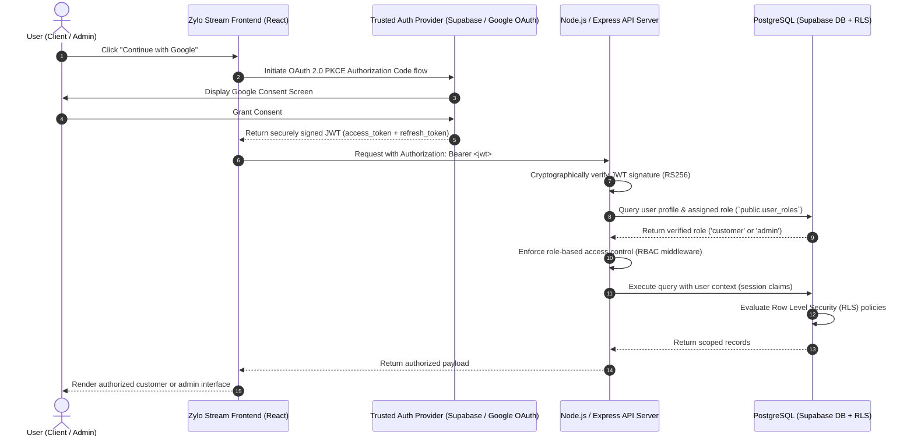

# Zylo Stream — Production Authentication & Authorization Architecture

## Overview
This document specifies the target production security model for Zylo Stream once the backend and PostgreSQL database are integrated. The frontend provides mock authentication and role-based route guards for evaluation, but production security will be enforced at the API and database levels.

---

## 1. Intended Production Authentication Flow



---

## 2. Seven-Stage Production Security Model

1. **User signs in through Google OAuth**:
   - Uses standard OAuth 2.0 Authorization Code flow with PKCE (Proof Key for Code Exchange).
   - Zero client secrets are bundled in the frontend bundle. Only public `VITE_SUPABASE_URL` and `VITE_SUPABASE_ANON_KEY` are used.

2. **Trusted Authentication Provider Verifies Identity**:
   - Google validates user credentials, handles MFA / passkeys, and returns identity tokens to the trusted provider (e.g., Supabase Auth).
   - A verified `user_id` (UUID) is created in `auth.users`.

3. **Backend Retrieves Assigned Role from Database**:
   - The user's role is never accepted from client-side state, URL parameters, or localStorage tokens.
   - A dedicated server-managed table `public.user_roles` maps `user_id -> role`.

4. **Server Authorizes Operation**:
   - Express/Node middleware intercepts incoming requests:
     ```javascript
     // Example production middleware
     export const requireRole = (allowedRoles) => (req, res, next) => {
       if (!req.user || !allowedRoles.includes(req.user.role)) {
         return res.status(403).json({ error: 'Access denied: Insufficient role permissions' });
       }
       next();
     };
     ```

5. **Database Access Policies Restrict Records (Row Level Security)**:
   - PostgreSQL RLS enforces tenant and customer isolation even if an application bug exists:
     ```sql
     -- Customers may only select their own subscriptions
     CREATE POLICY "customer_select_own_subscriptions"
     ON public.subscriptions
     FOR SELECT
     USING (
       auth.uid() = customer_user_id
       OR auth.jwt() ->> 'role' = 'admin'
     );
     ```

6. **Customer Requests Limited to Customer Records**:
   - All customer queries automatically filter by `customer_id = current_authenticated_user_id`.
   - Customers have no read or write visibility into other tenants or system-wide ledgers.

7. **Admin Requests Require Explicit Admin Role**:
   - Administrative endpoints (`/api/admin/*`) require the `admin` role explicitly assigned by database administrators.
   - Registering an account through public customer registration defaults strictly to `customer`.

---

## 3. Role Assignment Principles

| Principle | Specification |
|---|---|
| **Default Role** | Any new Google OAuth or email sign-up receives role: `customer` by default. |
| **Admin Provisioning** | Administrative roles cannot be self-selected or requested at registration. They must be explicitly granted by an existing administrator via database migration or internal admin console. |
| **Role Immutability** | Profile update endpoints validate that `role` cannot be modified by user payloads. |
| **Defense in Depth** | Frontend `RoleGuard` provides navigational UX; backend middleware and database RLS provide actual security. |

---

## 4. Current Frontend Mock Architecture

In the current frontend development phase (Frontend First, Backend Last):
- Client sessions are managed through [`authService.js`](file:///c:/Users/HP/OneDrive/Desktop/Hackathon/subscription-management-system/frontend/src/services/authService.js) and [`AuthContext.jsx`](file:///c:/Users/HP/OneDrive/Desktop/Hackathon/subscription-management-system/frontend/src/contexts/AuthContext.jsx).
- Client roles are explicitly segregated into `'customer'` (default identity: Eleanor Vance / Acme Creative Studio, ID: `customer_demo_001`) and `'admin'` (default identity: Julian Sterling, ID: `admin_demo_001`).
- Navigation protection is performed by [`RoleGuard.jsx`](file:///c:/Users/HP/OneDrive/Desktop/Hackathon/subscription-management-system/frontend/src/components/auth/RoleGuard.jsx), which redirects unauthorized role crossings to [`AccessDeniedPage.jsx`](file:///c:/Users/HP/OneDrive/Desktop/Hackathon/subscription-management-system/frontend/src/pages/auth/AccessDeniedPage.jsx).
- All mock data operations run against persistent client-side storage (`localStorage`) with full simulation notice banners.
